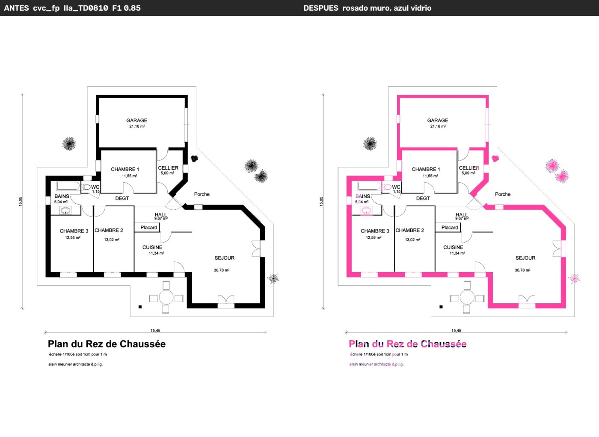
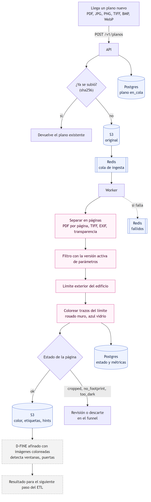
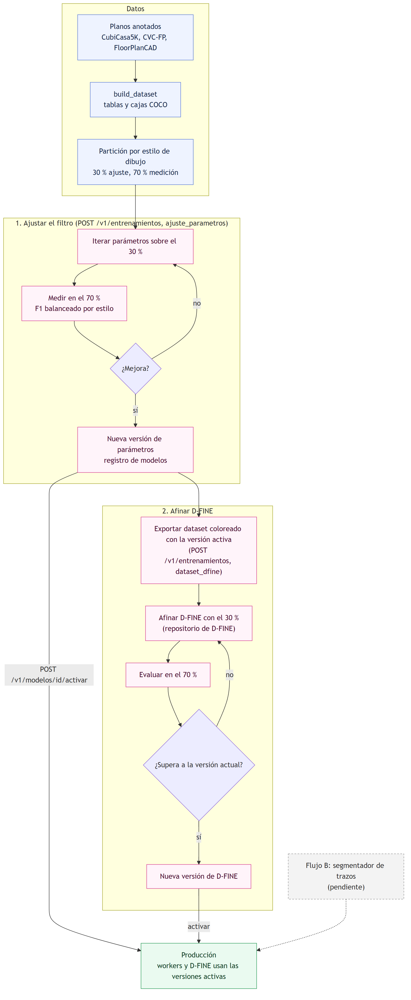

# ETL-CAD-Images

Filtro de planos: proyecto de código abierto para preparar planos arquitectónicos para
**modelos de visión**. Encuentra el límite exterior del edificio y colorea sus trazos: rosado
para el muro exterior, azul para el vidrio en el límite (ventanas, muros cortina). Las imágenes
coloreadas son la entrada con la que se entrenan y usan detectores como D-FINE. Acepta PDF,
PNG, JPEG, TIFF, BMP y WebP.



*Izquierda: plano original. Derecha: salida del filtro.*

## Flujos

### Producción: llega un plano nuevo



### Entrenamiento



Fuentes editables (Mermaid) en [docs/diagramas/](docs/diagramas/). Los diagramas de secuencia,
estados y tablas están en [docs/SISTEMA.md](docs/SISTEMA.md). Para regenerar las imágenes:
`npx @mermaid-js/mermaid-cli -i docs/diagramas/flujo_produccion.mmd -o docs/img/flujo_produccion.png -b white -s 2`.

## Antes y después

Ocho planos elegidos al azar entre los de medición (nunca usados para ajustar), dos por estilo
de dibujo. F1 del límite exterior contra la anotación manual.

| Plano | Estilo | Estado | F1 |
|---|---|---|---|
| [CubiCasa5K 14565](docs/img/antes_despues/cubicasa5k_colorful_14565.jpg) | colorful | ok | 0,94 |
| [CubiCasa5K 14887](docs/img/antes_despues/cubicasa5k_colorful_14887.jpg) | colorful | ok | 0,76 |
| [CVC-FP LZ1101](docs/img/antes_despues/cvc_fp_IIa_LZ1101.jpg) | CVC-FP | ok | 0,94 |
| [CVC-FP TD0810](docs/img/antes_despues/cvc_fp_IIa_TD0810.jpg) | CVC-FP | ok | 0,85 |
| [CubiCasa5K 4773](docs/img/antes_despues/cubicasa5k_high_quality_4773.jpg) | high_quality | ok | 0,83 |
| [CubiCasa5K 665](docs/img/antes_despues/cubicasa5k_high_quality_665.jpg) | high_quality | ok | 0,66 |
| [CubiCasa5K 7813](docs/img/antes_despues/cubicasa5k_high_quality_architectural_7813.jpg) | architectural | cropped | 0,72 |
| [CubiCasa5K 3528](docs/img/antes_despues/cubicasa5k_high_quality_architectural_3528.jpg) | architectural | cropped | 0,47 |

Se regeneran con `python scripts/make_sample.py`.

## Documentación

- [docs/SISTEMA.md](docs/SISTEMA.md): arquitectura, diagramas de flujo, secuencia, estados y datos; métricas.
- [docs/API.md](docs/API.md): endpoints de ingesta y entrenamiento con sus formatos JSON.
- [docs/INVESTIGACION.md](docs/INVESTIGACION.md): repositorios revisados y modelo base para el flujo B.

## Estructura

```
src/filtro_planos/
    ingest.py        archivo de entrada a páginas en gris (PDF, TIFF de varias páginas, EXIF...)
    preprocess.py    limpieza: tinta, líneas tenues, trazos finos, muros huecos
    envelope.py      límite exterior por relleno desde el borde y sus parámetros
    strokes.py       trazos del límite: muro o vidrio, a resolución completa
    render.py        trazos coloreados y canales de pista
    pipeline.py      paso completo por página; también CLI
    detector.py      detector opcional (D-FINE; la carga está pendiente)
    infra/           almacenamiento (disco o S3), colas (en línea o Redis), repositorio (memoria o Postgres)
    service/         API (FastAPI), worker de ingesta y trainer
    training/        ajuste 30/70 del filtro y dataset coloreado para D-FINE
    annotations.py, datasets.py, features.py, metrics.py, geometry.py
                     lectura de datasets anotados, features y métricas
scripts/             descarga de datos, base de datos, ajuste, evaluación, muestra
config/              parámetros ajustados del filtro
sql/                 esquema de Postgres
docs/                documentación e imágenes
tests/               pruebas
```

## Uso

Instalación (Python 3.11 o superior) y pruebas:

```bash
pip install -e ".[service,infra,dev]"
pytest --cov=filtro_planos
```

Procesar archivos desde la línea de comandos:

```bash
python -m filtro_planos.pipeline --input planos/ --output salida/
```

Servicio:

```bash
uvicorn filtro_planos.service.api:create_app --factory --port 8000   # API
python -m filtro_planos.service.worker                               # ingesta
python -m filtro_planos.service.trainer                              # entrenamiento
```

Sin `.env` todo corre local: la API procesa al recibir y guarda en `data/store/`. Con Redis,
Postgres (vía PgBouncer) y S3 se configura copiando `.env.example` a `.env`. Con Docker:

```bash
docker compose up --build
```

## Datos y ajuste

```bash
pip install -e ".[download,ml]"
python scripts/download_data.py      # CubiCasa5K, CVC-FP y FloorPlanCAD en data/raw
python scripts/build_dataset.py      # data/processed: planos, elementos, relaciones y COCO
python scripts/tune.py               # partición 30/70 y parámetros en config/
python scripts/make_sample.py        # mosaico y antes/después en data/output/muestra
```

## Métricas

- 44 pruebas, cobertura 72 % (límite exterior 97 %, ingesta 96 %, coloreado 95 %, API 94 %).
- Límite exterior: F1 mediano 0,783 balanceado por estilo de dibujo, en el 70 % de medición
  (3.584 planos que no se usaron para ajustar).
- 0,18 s por página (mediana) en CPU.

Detalle en [docs/SISTEMA.md](docs/SISTEMA.md).

## Licencias

Los tres datasets de referencia tienen licencia no comercial. Sirven para investigar y medir;
un producto necesita planos propios o con licencia. Las imágenes de `docs/img/antes_despues`
derivan de CVC-FP (CC BY-NC 4.0) y CubiCasa5K (CC BY-NC-SA 4.0).

## Fuentes

Datos
- CubiCasa5K: https://github.com/CubiCasa/CubiCasa5k
- CVC-FP: https://dag.cvc.uab.es/dataset/cvc-fp-database-for-structural-floor-plan-analysis/
- FloorPlanCAD: https://floorplancad.github.io/

Métodos
- Deep Floor Plan Recognition (Zeng et al., ICCV 2019): https://arxiv.org/abs/1908.11025
- FloorPlanCAD y panoptic symbol spotting (Fan et al., ICCV 2021): https://arxiv.org/abs/2105.07147
- CADTransformer (Fan et al., CVPR 2022): https://github.com/VITA-Group/CADTransformer
- SymPoint (Liu et al., ICLR 2024): https://github.com/nicehuster/SymPoint
- MitUNet (Parashchuk et al., 2025): https://arxiv.org/abs/2512.02413
- Skeleton Recall Loss (Kirchhoff et al., ECCV 2024): https://github.com/MIC-DKFZ/Skeleton-Recall
- Set-of-Mark Prompting (Yang et al., 2023): https://arxiv.org/abs/2310.11441
- D-FINE (Peng et al., ICLR 2025): https://github.com/Peterande/D-FINE
