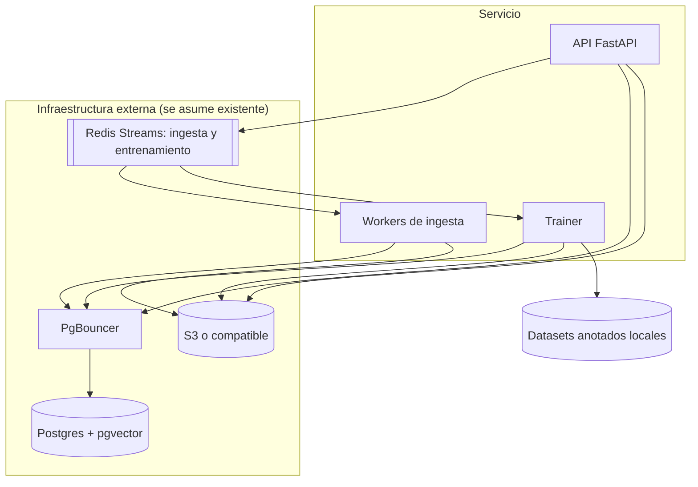
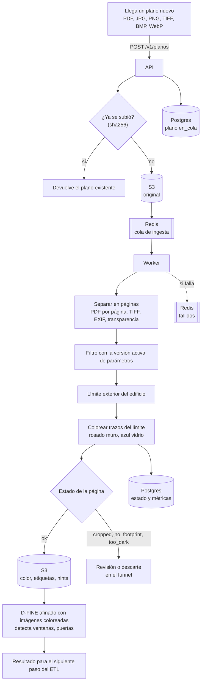
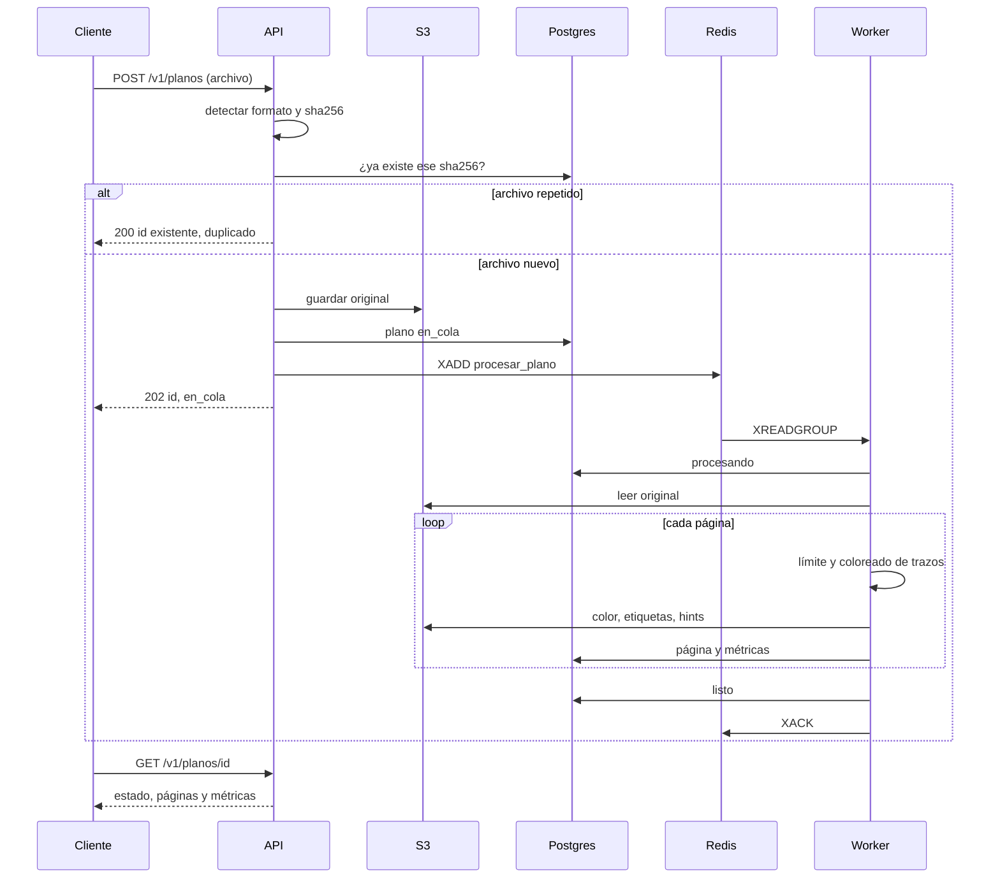
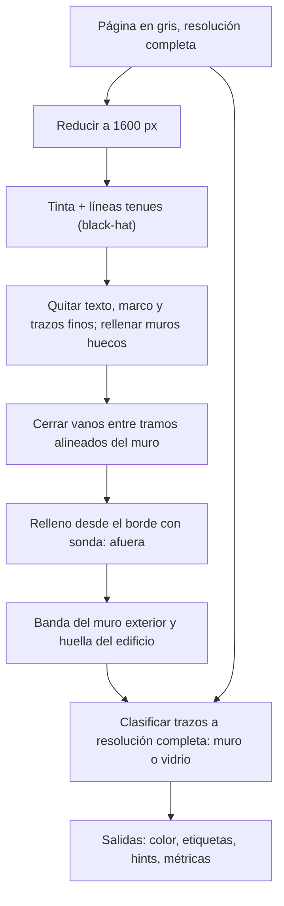
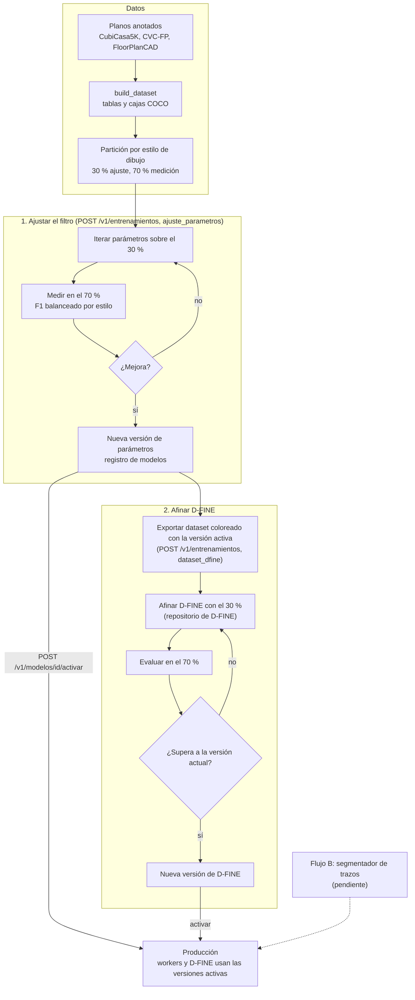
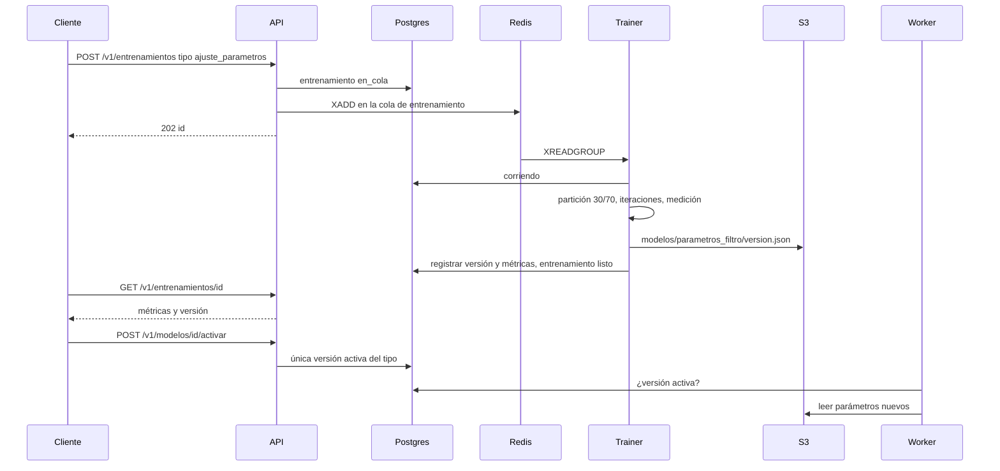
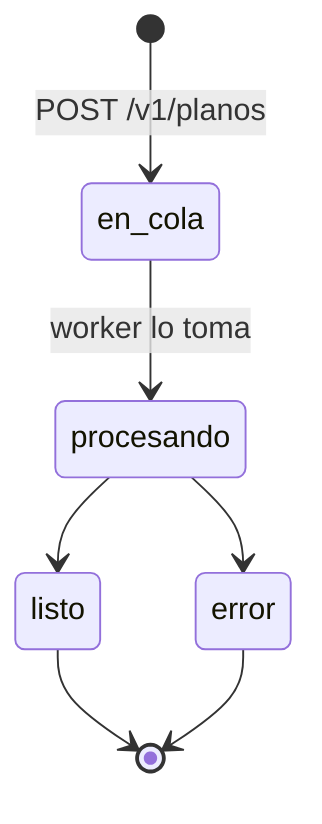
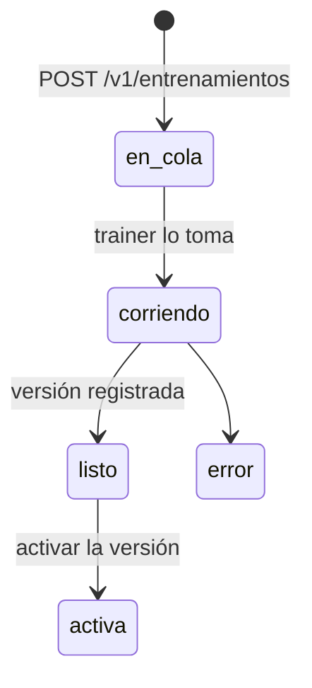
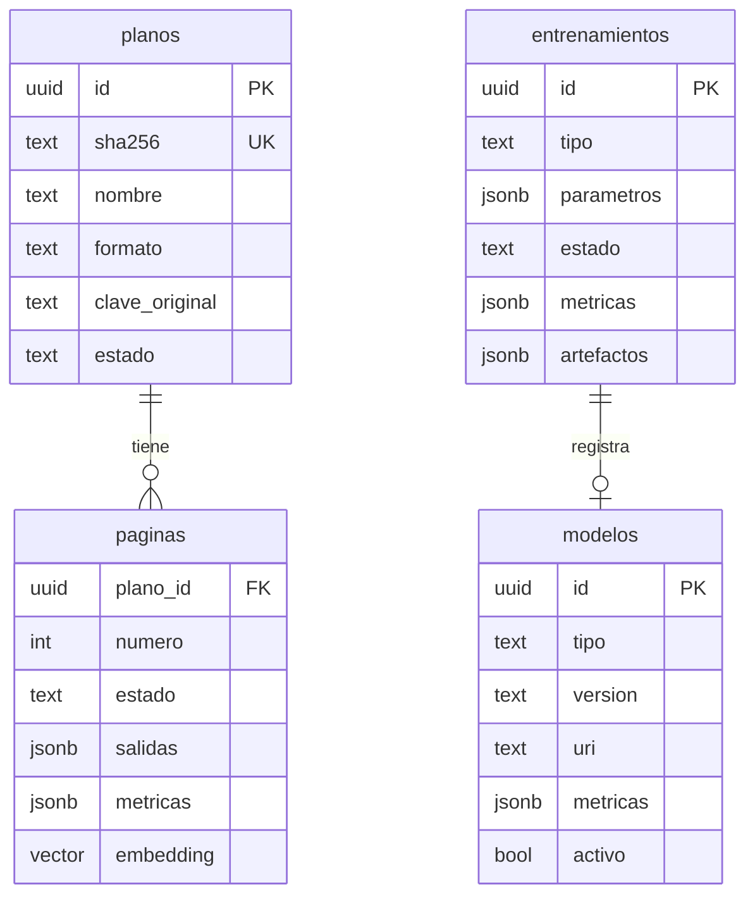

# Sistema

Proyecto de código abierto orientado a **modelos de visión** sobre planos arquitectónicos. El
filtro es un paso de ingesta: cada plano que llega (PDF o imagen) se convierte en páginas, en
cada página se busca el límite exterior del edificio y se colorean los trazos de ese límite,
rosado para el muro y azul para el vidrio (ventanas, muros cortina, vidrieras). Esas imágenes
coloreadas son la entrada con la que se entrenan y usan los modelos de visión, como D-FINE, que
no corre dentro de este paso.

Referencia de endpoints y formatos JSON: [API.md](API.md). Investigación de repositorios y
modelo base: [INVESTIGACION.md](INVESTIGACION.md).

## Componentes



| Componente | Qué hace | Código |
|---|---|---|
| API | Recibe planos, deduplica, encola, sirve resultados, lanza entrenamientos, activa versiones | `service/api.py` |
| Worker | Procesa planos página por página con la versión activa de parámetros | `service/worker.py` |
| Trainer | Ajusta parámetros y arma datasets para D-FINE, en su propia cola | `service/trainer.py`, `training/` |
| Cola | Redis Streams con grupo de consumidores y cola de fallidos | `infra/queue.py` |
| Almacenamiento | Originales, salidas, versiones de parámetros y datasets | `infra/storage.py` |
| Metadatos | Planos, páginas, entrenamientos y registro de modelos | `infra/repository.py`, `sql/001_init.sql` |
| Filtro | Límite exterior y coloreado de trazos | `envelope.py`, `strokes.py`, `pipeline.py` |

Redis, PgBouncer, Postgres con pgvector y S3 se asumen existentes: el código solo necesita sus
direcciones (`.env.example`). Para desarrollo y pruebas cada uno tiene reemplazo local: cola en
línea (procesa al recibir), disco y memoria.

## Flujo de producción: llega un plano nuevo

Fuente: [diagramas/flujo_produccion.mmd](diagramas/flujo_produccion.mmd).



D-FINE no corre dentro de la ingesta: consume las imágenes coloreadas en el paso siguiente.



## Dentro del filtro



El límite se busca a escala reducida, pero los trazos se clasifican sobre la imagen original:
al reducir, el vidrio se aclara y desaparece (en CVC-FP pasa de gris 0 a gris 139).

## Flujo de entrenamiento

Fuente: [diagramas/flujo_entrenamiento.mmd](diagramas/flujo_entrenamiento.mmd).



El paso "Afinar D-FINE" se hace con el repositorio de D-FINE sobre el dataset exportado; este
repositorio exporta el dataset y registra las versiones.



Reglas:

- La partición se hace una vez (`data/processed/splits.parquet`) y se reutiliza.
- Los cambios se deciden en el 30 % y se confirman en el 70 %, que nunca se usa para elegir.
- El objetivo es balanceado: promedio del F1 mediano de cada estilo, cada estilo pesa igual.
- D-FINE se entrena y se usa siempre con imágenes pasadas por la misma versión del filtro. Si
  cambia la versión activa, se vuelve a exportar el dataset y a afinar.

## Estados





## Datos



Claves en S3:

```
originales/<sha256>/<nombre>
procesado/<plano_id>/p<n>/{color,etiquetas,hints}.png
modelos/parametros_filtro/<version>.json
datasets/dfine/<version>/images/{train,val}/<plano>.png
datasets/dfine/<version>/annotations/{train,val}.json
```

Garantías:

- Mismo archivo, mismo plano: la API deduplica por sha256.
- Un trabajo que falla se confirma en su cola y queda en `<stream>:fallidos` con el error.
- Solo una versión activa por tipo (índice único parcial en `modelos`).
- Postgres se usa con `prepare_threshold=None` para funcionar con PgBouncer en modo transacción.
- `paginas.embedding` (pgvector) está reservado para buscar planos parecidos; aún no se llena.

## Métricas

Pruebas (`pytest --cov=filtro_planos`): 45 pruebas, todas pasan; cobertura total 72 %.

| Módulo | Cobertura | Qué cubren las pruebas |
|---|---|---|
| `envelope.py` | 97 % | Vano, esquina curva, muro a doble línea, vidriera tenue, porche con postes, plano recortado, plano oscuro |
| `ingest.py` | 96 % | PDF de varias páginas, TIFF, EXIF, transparencia, 16 bits, formato no soportado, tamaño máximo |
| `strokes.py` | 95 % | Dos clases en el límite, ventana dibujada en negro, interior sin color, grosor del trazo intacto |
| `service/api.py` | 94 % | Ingesta, duplicados, PDF, errores 404, 415, 422 y 501, entrenamiento, activación |
| `infra/storage.py` | 92 % | Disco y S3 (simulado con moto) |
| `infra/queue.py` | 86 % | Cola en línea y Redis Streams (simulado con fakeredis), cola de fallidos |
| `training/dfine_dataset.py` | 86 % | Imágenes coloreadas y COCO |

Sin cubrir todavía: `PostgresRepository` contra una base real, el ajuste completo con datos
(`training/tuning.py`, 34 %) y la imagen de Docker.

Calidad del límite exterior, F1 mediano en el 70 % de medición (3.584 planos), sin detector:

| Estilo | Parámetros iniciales | Ajustados |
|---|---|---|
| colorful | 0,747 | 0,775 |
| CVC-FP | 0,815 | 0,865 |
| high_quality | 0,774 | 0,816 |
| architectural | 0,614 | 0,675 |
| Balanceado | 0,738 | 0,783 |

Coloreado por clase, a nivel de trazo, contra muros y ventanas exteriores anotados (385 planos
del 70 %, F1 mediano balanceado por estilo):

| Regla | Muro (rosado) | Vidrio (azul) | Vidrio en CVC-FP |
|---|---|---|---|
| Solo tono (vidrio = trazo claro) | 0,739 | 0,202 | 0,045 |
| Tono + densidad de tinta (`glass_density_ratio` 0,75, elegido en el 30 %) | 0,750 | 0,339 | 0,487 |

La regla de densidad marca como vidrio el tramo del límite con mucha menos tinta que lo típico
del plano: es lo que separa una ventana dibujada en negro de un muro macizo. La precisión del
azul sigue baja (0,21): también se pintan puertas y trazos pegados al límite.

Rendimiento: 0,08 a 0,33 s por página (mediana 0,18 s) en CPU, medido en la muestra de 8 planos.

## Pendiente

- Flujo B: segmentador de trazos de dos clases (modelo base en INVESTIGACION.md).
- Medir el coloreado por clase (muro y vidrio por separado) contra las ventanas anotadas.
- Errores conocidos del flujo A: arcos de puerta junto al límite salen azules; textos y
  símbolos gruesos pegados al edificio salen rosados; vidrieras de una sola línea entre postes.
- Carga de D-FINE en `detector.py` para usos fuera de la ingesta.
